# AuctionIT ER Diagram

Entity-relationship diagrams for the **auctionit-new** Postgres schema.

**Source of truth:** [`src/db/schema/`](../src/db/schema/) (Drizzle table definitions and `.references()` FKs).  
[`relations.ts`](../src/db/schema/relations.ts) is incomplete for tooling — column FKs are authoritative.

## Legend

| Marker             | Meaning                                                      |
| ------------------ | ------------------------------------------------------------ |
| `PK`               | Primary key                                                  |
| `FK`               | Foreign key enforced in Postgres                             |
| `UK`               | Unique constraint / unique index                             |
| Solid relationship | Declared `.references()` FK                                  |
| Label `"soft ref"` | Logical link (int column, no FK) — often legacy sentinel `0` |
| Label `"logical"`  | App-level mapping without a DB FK                            |

**Column convention:** Entity boxes include identity/business keys and relationship-relevant fields. Routine audit columns (`created_by`, `updated_by`, `created_at`, `updated_at`, and similar) are omitted unless they are the only FK to another table.

**Cardinality:**

- `\|\|--o{` — one to many
- `\|\|--o\|` — one to zero-or-one
- `}\|--\|{` — many to many (via join table)

---

## Overview (relationships only)

```mermaid
erDiagram
  roles ||--o{ users : has
  roles ||--o{ role_permissions : grants
  permissions ||--o{ role_permissions : granted_by
  users ||--o{ user_clients : assigned
  clients ||--o{ user_clients : assigned
  users |o--o| bidders : "soft ref bidder_id"

  locations ||--o{ clients : located_in
  locations ||--o{ plant_locations : located_in
  locations ||--o{ material_locations : located_in
  locations ||--o{ bidders : located_in
  clients ||--o{ plant_locations : has
  clients ||--o{ material_locations : has
  clients ||--o{ items : owns
  clients ||--o{ auctions : runs
  clients ||--o{ client_document_logs : has
  clients ||--o{ bidder_block_logs : blocks
  clients ||--o{ service_invoices : billed
  plant_locations ||--o{ service_invoices : billed_at

  materials ||--o{ materials : parent_of
  materials ||--o{ items : categorizes
  uoms ||--o{ items : measures
  uoms ||--o{ auction_lots : measures
  client_document_types ||--o{ client_document_logs : typed_as

  bidders ||--o{ bidder_registrations : from
  bidders ||--o| bidder_bank_accounts : has
  bidders ||--o{ bidder_document_logs : has
  bidders ||--o{ bidder_block_logs : blocked
  bidders ||--o{ bidder_exemption_logs : exemptions
  bidder_document_types ||--o{ bidder_document_logs : typed_as
  bidders ||--o{ subscriptions : pays
  bidders ||--o{ subscription_payment_requests : requests
  subscription_types ||--o{ subscriptions : plan
  subscription_types ||--o{ subscription_payment_requests : plan
  payment_types ||--o{ subscriptions : mode
  subscriptions |o--o{ subscription_payment_requests : fulfills

  clients ||--o{ auction_lots : owns
  auctions ||--o{ auction_lots : contains
  auctions ||--o{ auction_lot_items : contains
  auctions ||--o{ auction_lot_bidder_maps : maps
  auctions ||--o{ auction_lot_emd_ranges : emd_bands
  auctions ||--o{ auction_documents : has
  auctions ||--o{ auction_bids : receives
  auctions ||--o{ auction_proxy_bids : receives
  auctions ||--o{ auction_lot_extensions : extends
  auctions ||--o{ auction_tnc_acceptances : accepted
  auctions ||--o{ lifting_client_logs : lifting
  auction_lots ||--o{ auction_lot_items : contains
  auction_lots ||--o{ auction_bids : receives
  auction_lots ||--o{ auction_proxy_bids : receives
  auction_lots ||--o{ auction_lot_watchlist : watched
  auction_lots ||--o{ auction_lot_extensions : extended
  auction_lots ||--o{ lifting_client_logs : lifting
  auction_lots ||--o{ lifting_engagement_logs : engagement
  plant_locations ||--o{ auction_lots : plant
  material_locations ||--o{ auction_lots : material_site
  items ||--o{ auction_lot_items : listed
  items ||--o{ lifting_client_logs : lifted
  bidders ||--o{ auction_lot_bidder_maps : invited
  bidders ||--o{ auction_bids : places
  bidders ||--o{ auction_proxy_bids : places
  bidders ||--o{ auction_lot_watchlist : watches
  bidders ||--o{ auction_tnc_acceptances : accepts
  auction_document_types ||--o{ auction_documents : typed_as
  benchmark_material_locations ||--o{ auction_lot_items : priced_vs
  benchmark_material_locations ||--o{ benchmark_prices : has

  bidders ||--o{ emd_passbook : "soft ref"
  bidders ||--o{ emd_reserved : "soft ref"
  bidders ||--o{ emd_transactions : "soft ref"
  bidders ||--o{ emd_refund_requests : "soft ref"
  auctions ||--o{ emd_passbook : "soft ref"
  auctions ||--o{ emd_reserved : "soft ref"
  auctions ||--o{ emd_transactions : "soft ref"
  auctions ||--o{ emd_refund_requests : "soft ref"
  emd_passbook ||--o{ emd_refund_requests : "soft ref passbook_trn_id"

  lifting_client_dispositions ||--o{ lifting_client_logs : "logical lifting_status"
  lifting_bidder_dispositions ||--o{ lifting_engagement_logs : disposition

  service_invoice_document_types ||--o{ service_invoice_documents : typed_as
  service_invoices ||--o{ service_invoice_documents : has
  service_invoices ||--o{ service_invoice_payment_logs : payments

  files }o--|| users : uploaded_by
  sms_templates
```

---

## 1. Identity & RBAC

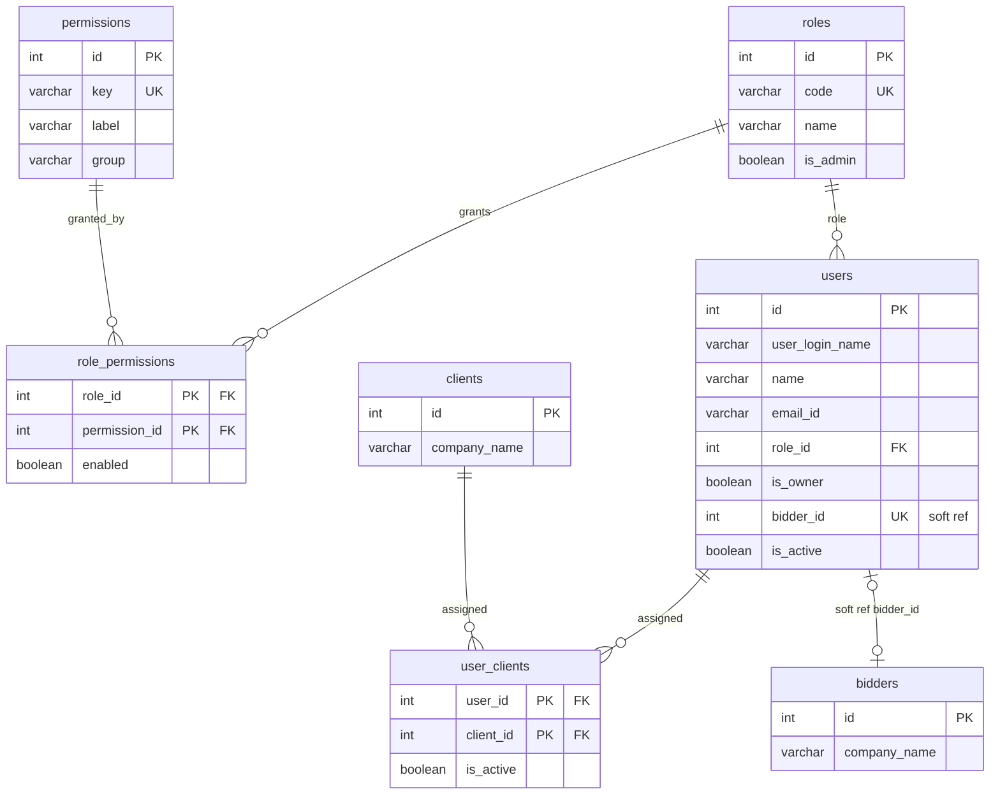

Notes:

- `roles.created_by` / `updated_by` are plain ints (no FK) to avoid a circular import with `users.role_id → roles`.
- `users.bidder_id` is unique (strict 1:1 login ↔ bidder) but has **no FK**.

---

## 2. Geography & clients

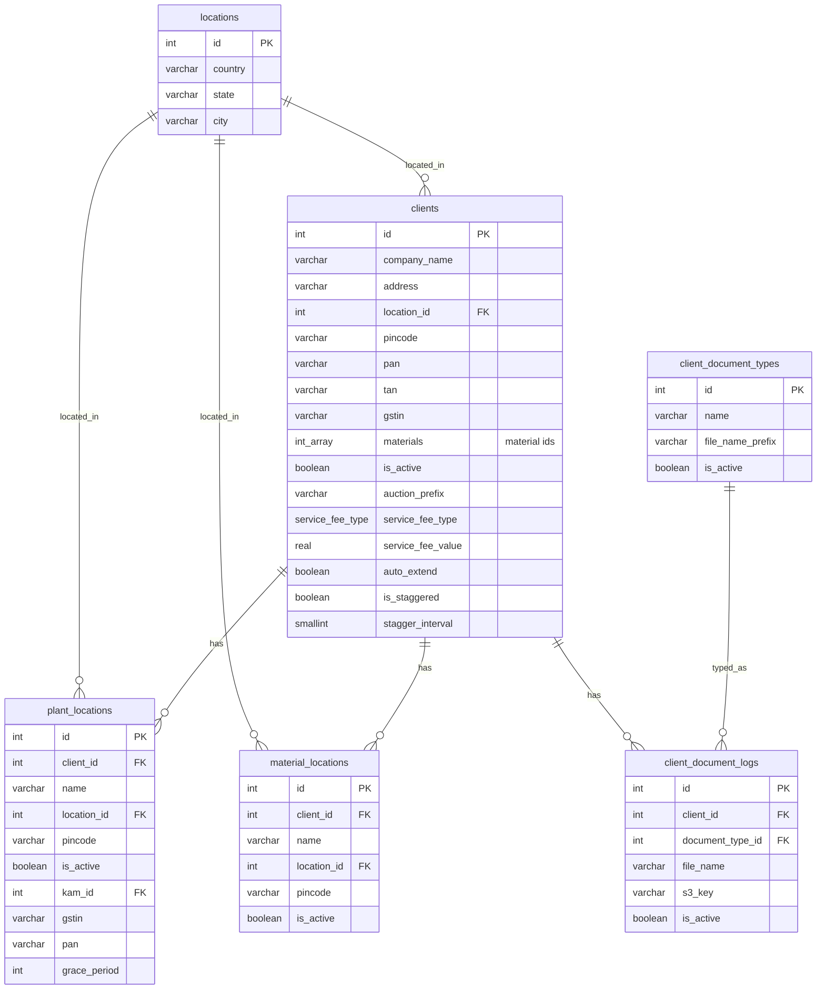

Notes:

- Unique index on `locations (country, state, city)`.
- `clients.materials` is an `int[]` of materials-master ids (no FK array).

---

## 3. Catalog masters

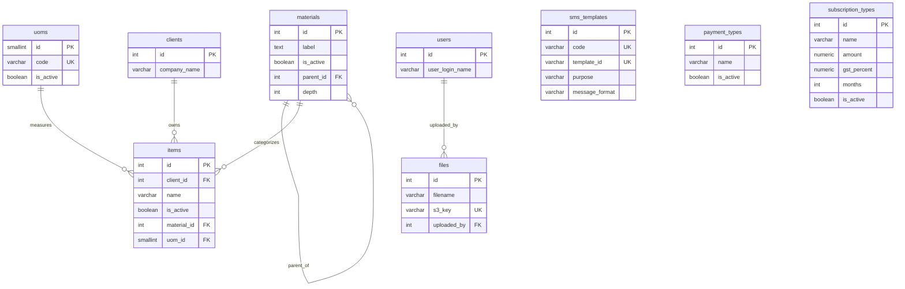

---

## 4. Bidders

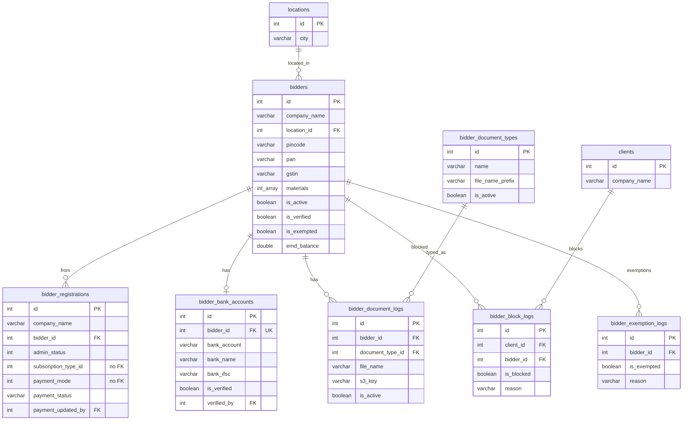

Notes:

- `bidder_bank_accounts.bidder_id` unique → effective **1:1**.
- `bidder_registrations` keeps legacy country/state/city ids and some subscription/payment ints **without FKs**.

---

## 5. Auctions & bidding

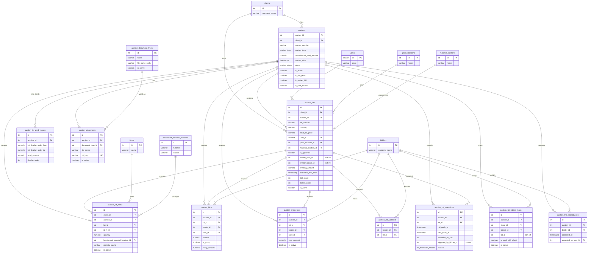

Notes:

- PK column on `auctions` is `auction_id` (mapped as `id` in Drizzle).
- Soft refs (no FK): `auction_lots.winner_user_id`, `winner_bidder_id`; `auction_lot_bidder_maps.lot_id`; `auction_lot_extensions.triggered_by_bidder_id`.
- Unique: `(auction_id, document_type_id)` on documents; `(bidder_id, lot_id)` on watchlist; `(auction_id, bidder_id)` on T&C.

---

## 6. EMD finance (soft refs)

Legacy MSSQL data uses sentinel `0` for “not applicable”, so these tables store plain ints/bigints **without foreign keys**.

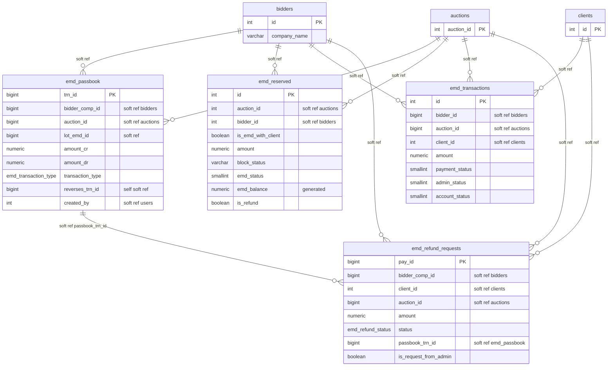

---

## 7. Subscriptions

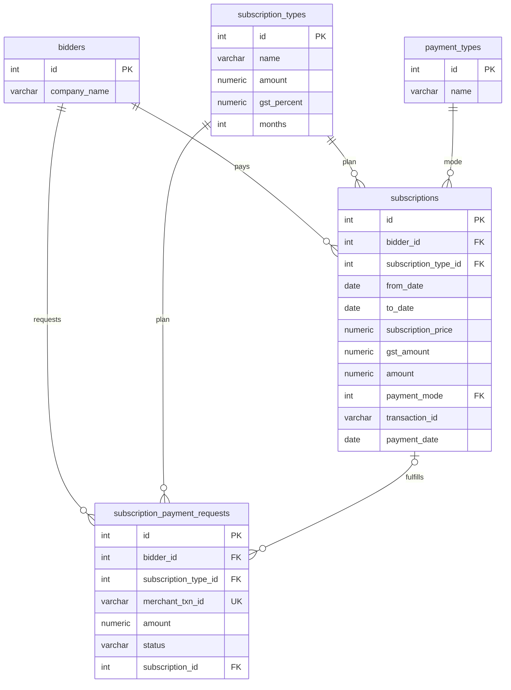

Notes:

- Subscription status is **derived** (`to_date >= today`), not stored.
- Payment request `status`: `requested` | `completed` | `failed` (varchar, not a Postgres enum).

---

## 8. Benchmarks

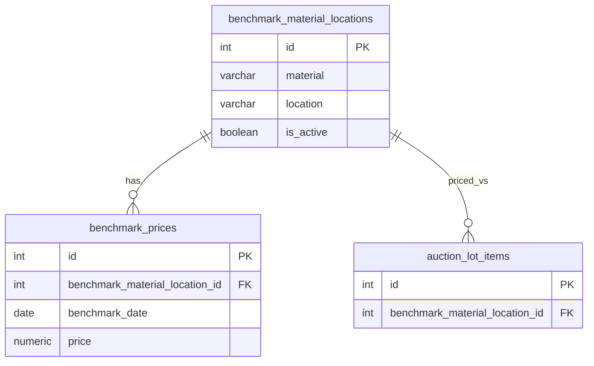

Notes:

- Unique `(material, location)` on combo master; unique `(combo_id, benchmark_date)` on prices.
- Combos are free-text material/location strings, **not** FKs to `materials` / `locations`.

---

## 9. Lifting / CRM

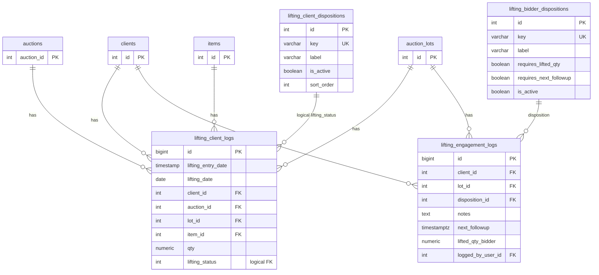

Notes:

- Fixed ids **1–5** on `lifting_client_dispositions` map to `lifting_client_logs.lifting_status` (no FK).
- `auction_lots.latest_lifted_*` is denormalized from the newest client lifting log row.

---

## 10. Service invoicing

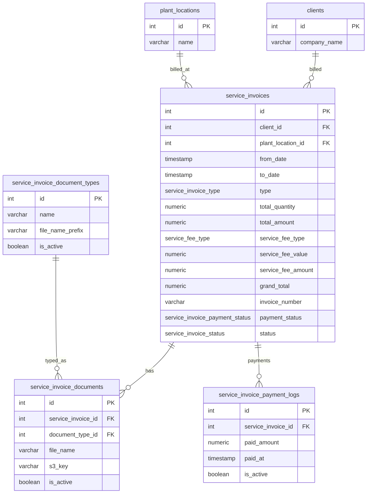

Notes:

- Unique `(service_invoice_id, document_type_id)`.
- Parent `paid_amount` / `unpaid_amount` / `payment_status` are derived from active payment log rows.

---

## Appendix A: Postgres enums

| Enum                             | Values                                                                                                                          | Defined in                                |
| -------------------------------- | ------------------------------------------------------------------------------------------------------------------------------- | ----------------------------------------- |
| `service_fee_type`               | `service_percentage`, `fixed_amount`, `pmt`                                                                                     | `clients.ts` (from `@auctionit/messages`) |
| `auction_type`                   | `forward`, `reverse`, `yankee`                                                                                                  | `auctions.ts`                             |
| `auction_status`                 | `draft`, `archived`, `published`, `closed`                                                                                      | `auctions.ts`                             |
| `emd_transaction_type`           | `emd_credit`, `auction_block`, `lot_block`, `auction_release`, `lot_release`, `user_refund`, `admin_correction`, `admin_cancel` | `emd-passbook.ts`                         |
| `emd_refund_status`              | `pending`, `approved`, `rejected`, `refunded`                                                                                   | `emd-refund-requests.ts`                  |
| `lot_extension_reason`           | `bid`, `auto_increment`, `stagger`                                                                                              | `auction-lot-extensions.ts`               |
| `service_invoice_type`           | `auto`, `manual`                                                                                                                | `service-invoices.ts`                     |
| `service_invoice_status`         | `draft`, `requested`, `generated`, `recheck`, `cancelled`                                                                       | `service-invoices.ts`                     |
| `service_invoice_payment_status` | `unpaid`, `partially_paid`, `paid`                                                                                              | `service-invoices.ts`                     |

**Not Postgres enums** (app constants / varchar / smallint codes): `ROLE_CODES`, `SMS_TEMPLATE_CODES`, `AUCTION_SCHEDULE_BUCKETS`, subscription payment request status, many legacy smallint status fields on EMD / registrations.

---

## Appendix B: Soft / logical relationships

| From                      | Column(s)                                                                     | To                                      | Notes                                    |
| ------------------------- | ----------------------------------------------------------------------------- | --------------------------------------- | ---------------------------------------- |
| `users`                   | `bidder_id`                                                                   | `bidders.id`                            | Unique 1:1; no FK                        |
| `auction_lots`            | `winner_user_id`                                                              | `users.id`                              | No FK                                    |
| `auction_lots`            | `winner_bidder_id`                                                            | `bidders.id`                            | No FK                                    |
| `auction_lot_bidder_maps` | `lot_id`                                                                      | `auction_lots.id`                       | No FK                                    |
| `auction_lot_extensions`  | `triggered_by_bidder_id`                                                      | `bidders.id`                            | No FK; null for auto-increment / stagger |
| `lifting_client_logs`     | `lifting_status`                                                              | `lifting_client_dispositions.id`        | Logical map (ids 1–5)                    |
| `emd_passbook`            | `bidder_comp_id`, `auction_id`, `lot_emd_id`, `created_by`, `reverses_trn_id` | bidders / auctions / self / users       | Sentinel `0`; no FKs                     |
| `emd_reserved`            | `auction_id`, `bidder_id`                                                     | auctions / bidders                      | No FKs                                   |
| `emd_transactions`        | `bidder_id`, `auction_id`, `client_id`                                        | bidders / auctions / clients            | No FKs                                   |
| `emd_refund_requests`     | `bidder_comp_id`, `client_id`, `auction_id`, `passbook_trn_id`                | bidders / clients / auctions / passbook | No FKs                                   |
| `clients` / `bidders`     | `materials`                                                                   | `materials.id`                          | `int[]`; no array FK                     |
| `bidder_registrations`    | `subscription_type_id`, `payment_mode`, legacy location ids                   | various                                 | Legacy ints; mostly no FKs               |
| `roles`                   | `created_by`, `updated_by`                                                    | `users.id`                              | Plain ints (circular-import avoidance)   |
