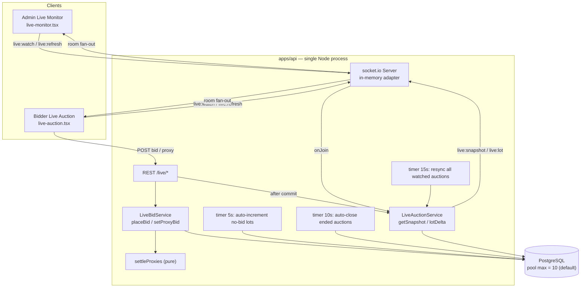
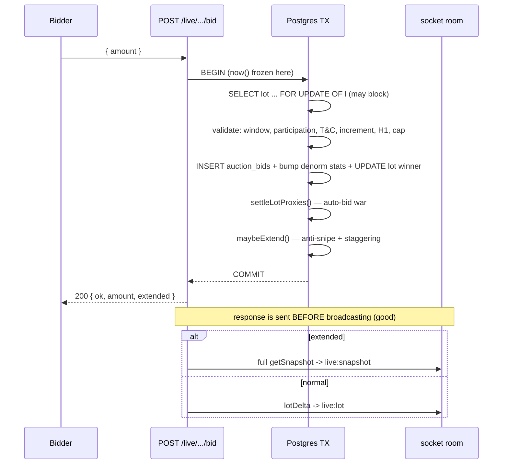
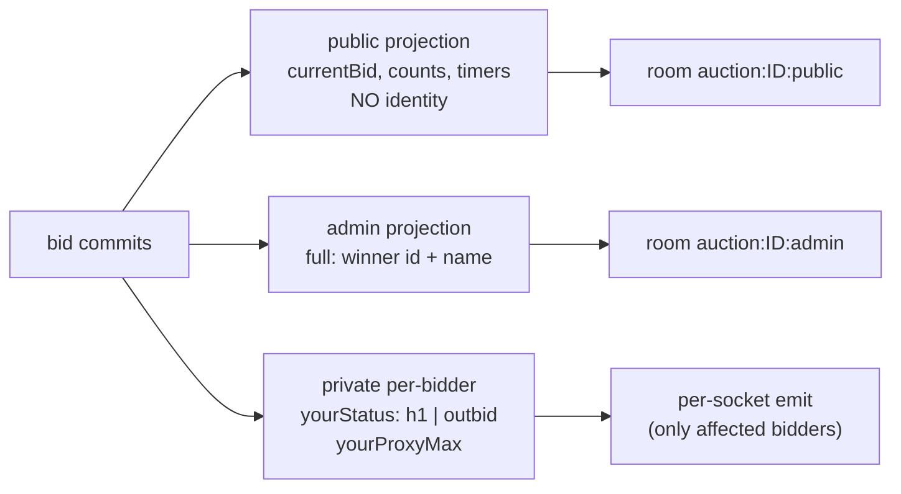

# Live Auction Engine — Architecture Audit

> Status: **v1 — initial deep review**
> Date: 2026-08-15
> Scope: `apps/api` live engine (socket + bid + snapshot services), `apps/admin` Live Monitor, `apps/bidder` Live Auction page.
> Method: full read of the live code paths, plus `EXPLAIN (ANALYZE, BUFFERS)` against the **real production-shaped database** to verify claims rather than infer them.

This is a living document. Findings are numbered (`LA-nn`) so we can track them as we work through fixes.

---

## 0. Executive verdict

The engine is **not architecturally broken — it is architecturally naive.** The hard parts that are usually got wrong are actually right: bids are serialized with a real `SELECT … FOR UPDATE` row lock, the proxy settlement rule is extracted into a pure, unit-tested function, and the bid write path itself is well indexed (measured **0.05 ms** for the participant check).

What is wrong is everything _around_ the bid:

1. **The read path is starving the write path.** The snapshot query does a **parallel sequential scan over 188,411 rows** every time it runs, and it runs on a 15-second server timer _per watched auction_, plus on demand from every client every 30 seconds. Meanwhile the connection pool is left at the node-postgres default of **10**. This — not lock contention — is why bids feel slow with concurrent users.
2. **There is no authorization on the socket at all.** Any authenticated user can join any auction room and receive the full lot list including competitors' company names.
3. **Two genuine money-correctness bugs** in the proxy/settlement path, one of which is provable in one line of SQL.
4. **The system cannot be scaled horizontally today.** Not "would need tuning" — adding a second API instance would actively break live auctions.

Underpinning all four: **the engine has never run in production.** Every new-engine-only table is empty — zero proxy bids, zero extensions, zero watchlist rows, zero T&C acceptances, zero bids carrying an IP. All 2.08M bids are migrated legacy data, the newest from 2026-05-16 (§1.4). There has never been a feedback loop capable of surfacing these defects, which is precisely why they accumulated. It also means there is nothing to migrate or unwind — but the untested proxy path represented **20% of legacy bid volume**, so it will be exercised hard from day one.

To answer the three questions directly:

- **"Are websockets even firing?"** — Yes. The transport works; join/emit/room fan-out is correct. The problem is not delivery, it is _what_ is delivered, _how often_, and _what it costs to produce_.
- **"Why are bids slow with concurrent users?"** — Resource starvation from the snapshot storm (LA-01, LA-02, LA-03), not the bid transaction itself.
- **"Is the Live Monitor refreshing properly?"** — Mostly yes, but its countdown baseline is systematically optimistic (LA-14), deltas can arrive out of order with no version guard (LA-15), and it burns one `setInterval` per lot row (LA-13).

**Severity register** (detail in §3):

- SEV-1 (correctness/security/availability): LA-01 … LA-09
- SEV-2 (scale, robustness, hygiene): LA-10 … LA-20
- SEV-3 (UI system consistency): LA-21 … LA-25

---

## 1. What is actually built

### 1.1 Component map



### 1.2 The bid lifecycle as built



The **reply-then-broadcast** split (`src/routes/live.ts:16-35`, `171-176`) and the delta-vs-snapshot distinction are genuinely good design decisions. Credit where due.

### 1.3 Measured ground truth

Taken from the live database on 2026-08-15:

- `auction_lot_bidder_maps` — **12,389,761** rows
- `auction_bids` — **2,077,676** rows
- `auction_lots` — **188,411** rows
- `auctions` — **8,081** rows
- `auction_proxy_bids` — **0 rows**

Indexes that exist on the live tables:

- `auction_bids`: pkey, `auction_bids_lot_id_bidder_id_idx`
- `auction_proxy_bids`: pkey, `auction_proxy_bids_lot_active_idx`
- `auction_lot_bidder_maps`: pkey, `auction_lot_bidder_maps_bidder_auction_idx`
- `auction_lots`: **pkey only**
- `auctions`: **pkey only**

### 1.4 The new engine has never run in production — and that cuts both ways

Every table and column that only the new Postgres engine writes is empty:

| Signal (new-engine only)                 | Count |
| ---------------------------------------- | ----- |
| `auction_proxy_bids` rows                | **0** |
| `auction_lot_extensions` rows            | **0** |
| lots with `extension_count > 0`          | **0** |
| `auction_bids` rows with a non-null `ip` | **0** |
| `auction_lot_watchlist` rows             | **0** |
| `auction_tnc_acceptances` rows           | **0** |

All 2,077,676 bids are **migrated legacy MSSQL data**, spanning 2017-07-29 to 2026-05-16 — and nothing has been written since, three months ago.

**The good news:** there is no production data to migrate or unwind. Every correctness bug in §3 can be fixed forward, and no already-settled lot needs re-auditing.

**The bad news, and it is the more important half:** proxy/auto-bidding is not a fringe feature in this business. In the legacy data it accounts for **413,405 bids — 20% of all bid volume — across 34,232 distinct lots.** So the single most intricate and least verified path in the system (unit tests on the pure function only; zero integration coverage; never executed against a real database) is the one that will absorb roughly a fifth of all traffic from the first day it goes live.

LA-07 and LA-08 are therefore not latent defects to schedule. They are defects that will surface immediately, in the money path, on lots that customers have paid EMD to bid on.

**There is one published auction on the calendar: 2026-08-26** — eleven days out. If that is intended to run on this engine, it is the deadline for Phase 1 and Phase 2.

---

## 2. Answering the three questions with evidence

### 2.1 "I don't know whether websockets are even firing"

They are. The handshake authenticates from the per-app session cookie (`src/live/socket.ts:80-102`), rooms are keyed `auction:<id>`, and `emitToAuction` fans out correctly. The client re-emits `live:watch` on every reconnect (`apps/admin/src/lib/use-live-auction.ts:186-225`), so recovery after a drop works.

What you are likely perceiving as "not firing" is one of these:

- The **default transport list is** `polling,websocket` (`apps/bidder/src/lib/use-live-auction.ts:11-17`). The first connection is HTTP long-polling and only _upgrades_ to a real WebSocket if the proxy in front of the API permits `Upgrade`. If nginx/Cloudflare is not configured for it, you are running the entire live auction over long-polling and never notice, because it still works — just with far higher latency and far more load.
- Under the snapshot storm (§2.2) the event loop and the DB are both saturated, so emits are late. The socket is firing; the payload just took 4 seconds to produce.

**Action:** instrument the upgrade. Log `socket.conn.transport.name` on connect and after `upgrade`, and surface it in the Live Monitor header. This is a five-minute change that removes all guesswork. Then decide deliberately whether to force `transports: ["websocket"]`.

### 2.2 "Multiple bids are not being placed fast for multiple concurrent users"

This is the headline finding, and it is measurable.

**The bid itself is fast.** The participant gate against the 12.4M-row map table uses its index cleanly:

```
Index Scan using auction_lot_bidder_maps_bidder_auction_idx
  Index Cond: ((bidder_id = 100) AND (auction_id = 39))
  Execution Time: 0.053 ms
```

**The snapshot is not.** This is the core of `getSnapshot`, which has no index to work with:

```
Gather  (actual time=17.452..36.976 rows=345 loops=1)
  Workers Planned: 2   Workers Launched: 2
  Buffers: shared hit=15494 read=7563
  ->  Parallel Seq Scan on auction_lots l
        Filter: (is_active AND (auction_id = 39))
        Rows Removed by Filter: 62689
  Execution Time: 37.061 ms
```

Read that carefully. Every single snapshot:

- scans **all 188,411 lots** to find the ~345 belonging to one auction,
- touches **23,057 buffer pages (~180 MB of buffer traffic)**,
- and **launches 2 parallel workers**, so it occupies _three_ backends, not one.

Now compound it. `getSnapshot` is invoked from **five** places:

| Trigger                     | Location                              | Frequency                                       |
| --------------------------- | ------------------------------------- | ----------------------------------------------- |
| Socket join                 | `src/index.ts:122-127`       | per room joined                                 |
| Server resync loop          | `src/index.ts:132-138`       | **every 15 s × every watched auction**          |
| Client `live:refresh`       | `src/live/socket.ts:159-165` | **every 30 s × every tab × every watched room** |
| Extending bid               | `src/routes/live.ts:175`     | per anti-snipe bid                              |
| Auto-increment / auto-close | `src/index.ts:154`, `179`    | per affected auction                            |

And the Live Monitor defaults to **auto mode — it watches every live auction at once** (`apps/admin/src/pages/live-monitor.tsx`, `manualAuctions` defaults false). So with 10 live auctions and 3 admin tabs open, steady state is roughly:

- server resync: 10 snapshots / 15 s
- client refresh: 3 tabs × 10 rooms = 30 snapshots / 30 s

≈ **100 full-table scans per minute, ≈ 2.3 GB/min of buffer churn, on a connection pool of 10** — before a single bid is placed.

The pool is the choke point:

```11:14:src/db/index.ts
const pool = new pg.Pool({
  connectionString: env.DATABASE_URL,
  options: "-c timezone=Asia/Kolkata",
});
```

No `max`, so node-postgres defaults to **10**. No `connectionTimeoutMillis`, no `statement_timeout`. A bid arriving during a resync burst queues behind snapshot scans in the driver, _before it ever reaches Postgres_. That is your latency, and it is why it gets dramatically worse with more concurrent users and more parallel auctions — exactly the symptom described.

The 15 s loop makes it worse in two further ways:

```132:138:src/index.ts
setInterval(() => {
  for (const auctionId of getActiveAuctionIds()) {
    void liveAuctionService.getSnapshot(auctionId).then((snapshot) => {
      if (snapshot) emitToAuction(auctionId, "live:snapshot", snapshot);
    });
  }
}, 15_000);
```

- **No in-flight guard and no concurrency limit.** Unlike the auto-increment and auto-close timers (which both use a `running`/`closing` boolean), this one fires all N snapshots in parallel as detached promises. If a tick takes longer than 15 s — which it will under load — ticks pile on top of each other and the system enters a death spiral.
- `getActiveAuctionIds()` **reads socket rooms.** One admin who leaves a tab open overnight keeps every auction permanently "active", so the server keeps paying full snapshot cost for auctions nobody is looking at.

### 2.3 "I don't know whether the Live Monitor is refreshing properly"

Functionally it is: joins push a snapshot, bids push a delta, and there are two independent refresh paths. But three things make it _look_ unreliable:

- The countdown baseline is the **client-side arrival time** of the snapshot, not the server clock (LA-14). Every countdown is optimistic by however long the snapshot took to compute and travel — which, per §2.2, can be seconds.
- `live:lot` deltas carry **no version or sequence number** (LA-15), so a delta that was generated before a snapshot but delivered after it will silently overwrite the newer H1.
- Every lot row runs its own 1-second interval (LA-13), so with a few hundred lots the tab is doing hundreds of state updates per second and the whole list re-renders each time. It feels janky and stale even when the data is fine.

---

## 3. Findings

### SEV-1 — Correctness, security, availability

---

#### LA-01 · `auction_lots` has no index on `auction_id`

Every live read path filters `WHERE l.auction_id = ? AND l.is_active`, and there is no index to serve it. Proven above: parallel seq scan, 188k rows, 37 ms, 23k buffers, per snapshot.

`auctions` is likewise unindexed beyond its pkey, so `listLive`'s `WHERE status = 'published' AND auction_date::date = today` also scans.

This single missing index is the largest contributor to live-auction latency.

---

#### LA-02 · Connection pool left at the default of 10, with no timeouts

`src/db/index.ts:11-14`. Bid transactions hold a connection for their full duration (validate → insert → settle proxies → extend → stagger). Snapshot scans hold connections and spawn parallel workers. Ten slots is not a live-auction pool; it is a prototype pool. With no `connectionTimeoutMillis` or `statement_timeout`, saturation manifests as unbounded queueing instead of fast, visible failure.

---

#### LA-03 · The 15 s resync loop has no in-flight guard and unbounded fan-out

`src/index.ts:132-138`. Detailed in §2.2. Note that the two _other_ timers in the same file do this correctly — the pattern was known and simply not applied here.

---

#### LA-04 · No authorization on socket room membership

```107:116:src/live/socket.ts
s.on("live:join", async (rawId: unknown) => {
  const auctionId = Number(rawId);
  if (!Number.isInteger(auctionId) || auctionId <= 0) return;
  for (const room of s.rooms) {
    if (room.startsWith("auction:")) s.leave(room);
  }
  s.join(auctionRoom(auctionId));
  await handlers.onJoin?.(s, auctionId);
});
```

The handshake authenticates _identity_ and nothing else. There is **no check that the user is a registered participant of the auction they are joining** — not in `live:join`, not in `live:watch`, and not in `onJoin` (`src/index.ts:122-127`). Any bidder with a valid session can open the browser console and run `socket.emit("live:watch", [1,2,3,...])` to receive live snapshots for every auction in the system, including other clients' auctions.

The snapshot payload contains `winnerBidderName` — the **H1 bidder's company name** (`src/services/live-auction.service.ts:138`). In a competitive scrap-auction marketplace this is direct competitor intelligence.

The codebase already understands this risk and guards the REST endpoints for exactly this reason:

```68:79:src/routes/live.ts
// Per-lot drill-downs for the admin Live Monitor sheets. Admin-only: exposing
// who bid what would leak competitor info to bidders, so these reject bidders.
function requireAdmin(...)
```

…and then leaks the same class of information through the socket, which has no such gate. The stated policy and the implementation contradict each other.

---

#### LA-05 · Per-lot visibility for bidders is enforced only in the browser

The server broadcasts **every lot of the auction** to every socket in the room. The bidder frontend then hides the ones the bidder isn't mapped to:

```200:209:apps/bidder/src/pages/live-auction.tsx
// Per-auction set of lot ids this bidder is attached to; `null` = all lots
// (auction-wide map). Used to hide lots the bidder isn't mapped to from the
// shared live snapshot (which carries every lot of the auction).
const attachedByAuction = useMemo(() => { ... }, [auctions]);
```

The comment states the design plainly. Client-side filtering is presentation, not authorization — the full payload is in the browser's network tab. Per-lot bidder mapping is a deliberate commercial control, and right now it does not hold.

---

#### LA-06 · `live:refresh` is an unauthenticated, unthrottled DB amplifier

```159:165:src/live/socket.ts
s.on("live:refresh", async () => {
  for (const room of s.rooms) {
    if (!room.startsWith("auction:")) continue;
    const id = Number(room.slice("auction:".length));
    if (Number.isInteger(id) && id > 0) await handlers.onJoin?.(s, id);
  }
});
```

One client message triggers one full snapshot **per watched room**, with no rate limit and no cost ceiling. Combined with LA-04 (join any room) and LA-01 (each snapshot is a 188k-row scan), a single authenticated user can put the database on the floor with a `for` loop in the console. This needs no sophistication and leaves no obvious trace.

---

#### LA-07 · Proxy timestamps are written in UTC while bid timestamps are written in IST

The whole schema uses `timestamp without time zone` holding **IST wall-clock**, and the pool pins the session timezone to make `now()` and `defaultNow()` behave (`src/db/index.ts:8-14`). `auction_bids.created_at` follows that convention — the insert omits the column and takes the `defaultNow()`.

The proxy insert does not:

```386:391:src/services/live-bid.service.ts
await tx.execute(sql`
  INSERT INTO auction_proxy_bids
    (auction_id, lot_id, bidder_id, user_id, max_amount, is_active, created_at)
  VALUES (${input.auctionId}, ${input.lotId}, ${input.bidderId}, ${input.userId},
          ${maxAmount.toFixed(2)}, true, ${now}::timestamp)
`);
```

where `now = new Date().toISOString()` (line 379) — a **UTC** string. Postgres silently discards the `Z` when casting to `timestamp without time zone`. Verified against the live database:

```
   now_session                    | js_toisostring_cast
 2026-08-15 21:16:06.596487+05:30 | 2026-08-15 15:41:00
```

Every proxy row is therefore stamped **5 h 30 m in the past** relative to every bid row.

This is not cosmetic. That timestamp is the settlement tie-break key:

```450:456:src/services/live-bid.service.ts
SELECT bidder_id, user_id, max_amount,
       (EXTRACT(EPOCH FROM created_at) * 1000)::bigint AS order_ms
FROM auction_proxy_bids
WHERE lot_id = ${ctx.lotId} AND is_active = true
```

and it is compared directly against the manual leader's order, which is derived from `auction_bids.created_at` — i.e. IST (lines 481-492). `settleProxies` breaks ties by lowest `order` (`src/lib/auctions/proxy-settle.ts:68-70`), so **a proxy always appears ~5.5 hours earlier than any manual bid placed at the same moment, and therefore always wins the tie-break regardless of actual chronology.**

The `Contender.order` doc comment says the key should be "the proxy row id for proxies (submission order)". The implementation uses a timestamp instead, in the wrong time base. Also note `updated_at` on lots and retired proxies has the same 5.5 h skew — cosmetic there, but it will mislead anyone debugging an incident.

---

#### LA-08 · `setProxyBid` never requires the proxy to beat the current H1

`placeBid` correctly rejects a bid that merely ties the leader:

```169:171:src/services/live-bid.service.ts
if (hasBids && paise(amount) <= paise(currentH1)) {
  return reject("Outbid — the current highest bid is equal or higher.");
}
```

`setProxyBid` has no equivalent gate. Its validations are: at least `minMax` (the start price once the lot has bids), a whole multiple of the increment, within `max_bid_limit`, and raise-only against the bidder's own prior max (lines 353-376). Nothing compares `maxAmount` to `winning_amount`.

Combined with LA-07, this is exploitable:

1. Bidder A manually bids ₹100. Lot H1 = ₹100, winner = A.
2. Bidder B sets a proxy max of **₹100** — accepted, since no gate rejects it.
3. Settlement builds contenders: B (proxy, max 100, order in UTC) and A (manual leader, max 100, order in IST).
4. Equal maxes → tie-break on lowest order → **B wins**, because the UTC skew makes B look 5.5 h earlier.
5. `changed` is true (winner differs), so an auto-bid is written for B and the lot's winner flips to B at the same ₹100 (lines 533-561).

**A later bidder takes the lot from the standing leader without paying more.** Even with LA-07 fixed, allowing a proxy at exactly the current H1 is wrong on its own — it should be rejected symmetrically with `placeBid`.

---

#### LA-09 · `now()` is frozen at transaction start, so the endgame clock is stale

`now()` in Postgres is `transaction_timestamp()` — fixed when the transaction begins, _not_ when the `FOR UPDATE` lock is finally granted. Both time gates read it:

```99:100:src/services/live-bid.service.ts
EXTRACT(EPOCH FROM (((a.auction_date::date + l.start_time) AT TIME ZONE 'Asia/Kolkata') - now()))::int AS time_to_start_sec,
EXTRACT(EPOCH FROM ((COALESCE(l.extended_end_time, (a.auction_date::date + l.end_time)) AT TIME ZONE 'Asia/Kolkata') - now()))::int AS time_left_sec,
```

Postgres' EvalPlanQual re-reads the _row_ after the lock is granted, so `winning_amount` is correctly fresh — but `now()` is not re-evaluated. When several bidders contend for the same lot, each waits in the lock queue while its clock stands still.

The consequences land precisely where they hurt most, in the last seconds of a lot:

- `if (lot.time_left_sec <= 0) return reject(...)` — a bid that waited out the close in the lock queue is **accepted after the lot ended**.
- `maybeExtend` tests `lot.time_left_sec <= window` — the anti-snipe decision is made on a stale clock, so extensions are granted or withheld incorrectly during exactly the burst the feature exists for.

The fix is to evaluate the time gates with `clock_timestamp()` (wall clock, re-read on every call) in a statement issued _after_ the lock is held, rather than in the locking `SELECT` itself.

---

### SEV-2 — Scale, robustness, hygiene

---

#### LA-10 · Cannot run more than one API instance

`createSocketServer` uses the **default in-memory adapter** (`src/live/socket.ts:69-75`) — no `@socket.io/redis-adapter`, and neither `redis` nor `ioredis` is a dependency of `apps/api`. Rooms and `emitToAuction` are therefore process-local.

Three things must all be true before a second instance can exist, and none are:

- a shared adapter (Redis/Postgres `LISTEN/NOTIFY`) so broadcasts cross processes,
- sticky sessions at the load balancer, or `transports: ["websocket"]` only — the client currently defaults to `polling,websocket`, and polling without affinity breaks immediately,
- deduplicated schedulers. Auto-increment already takes `pg_try_advisory_xact_lock` (`src/services/auto-increment.service.ts:73-76`), but the **15 s resync** and the **10 s auto-close sweep** do not — each instance would duplicate them.

Worth stating plainly: today the platform's throughput ceiling is one Node process. There is no horizontal escape hatch.

---

#### LA-11 · `lotBidders` scans the 12.4M-row map table, and re-fires on every bid

Measured **261 ms**, 16,589 buffers:

```
Bitmap Heap Scan on auction_lot_bidder_maps m
  Recheck Cond: (auction_id = l.auction_id)
  Filter: (is_active AND ((lot_id IS NULL) OR (lot_id = l.id)))
```

The existing index is `(bidder_id, auction_id)`; this query joins on `auction_id` alone, so the leading column is missing and the index can't be used efficiently. Worse, the admin panel keys the query on `bidCount`:

```209:214:apps/admin/src/components/live-monitor/lot-detail-rows.tsx
const { data, isLoading } = useQuery({
  queryKey: ["live-lot-bids", lotId, bidCount],
  ...
```

so **every bid on an expanded lot triggers a fresh 261 ms scan**, per watching admin. During an active endgame, that is the opposite of the desired behaviour.

---

#### LA-12 · Denormalized bid stats are written on the hot path and then ignored

`bumpLotBidStats` runs inside the bid lock on every bid (`src/services/live-bid.service.ts:27-46`), maintaining `bid_count`, `bidder_count`, and a `bidder_ids` integer array via `array_append` with an `= ANY(bidder_ids)` membership test — an O(n) scan of an unbounded array, inside the critical section.

But `getSnapshot` and `lotDelta` **don't read those columns** — they recount with correlated subqueries (`src/services/live-auction.service.ts:144-145`, `219-220`). So we pay write amplification on the hot path _and_ read amplification on the read path, and carry the risk that the two disagree. (`bid_count` is read by the auto-increment gate, so the columns can't simply be dropped — but the snapshot should use them rather than recount.)

---

#### LA-13 · One `setInterval` per lot row

`useSecondTick` is called by the page **and** by every `LotRow` (`apps/admin/src/pages/live-monitor.tsx:175` and `:466`; same pattern in the bidder page). With 200 lots that is **201 intervals and 201 state updates per second**, each re-rendering the entire list — there is no `React.memo` on `LotRow`, no `useCallback` on the handlers passed into it, and no virtualization anywhere.

One tick source lifted to context, plus memoized rows, removes essentially all of this.

---

#### LA-14 · Countdowns are anchored to client arrival time, and `serverTime` is dead code

```284:294:apps/bidder/src/lib/use-live-auction.ts
export function lotTimeLeft(lot: LiveLot, receivedAt: number): number {
  const elapsed = receivedAt ? (Date.now() - receivedAt) / 1000 : 0;
  return Math.max(0, Math.floor(lot.timeLeftSec - elapsed));
}
```

Absolute client clock skew cancels out here (both terms come from the same clock), so this is not the "user's clock is wrong" bug it first appears to be. The real defect is a **systematic optimistic bias**: `timeLeftSec` was computed on the server _before_ query execution, serialization, queueing and network transit, but the client starts counting from _arrival_. Every client believes it has more time than it does, by the full server-to-client latency — which under the load described in §2.2 is seconds, not milliseconds. In an anti-sniping auction, a countdown that is systematically slow is a fairness problem.

`serverTime` is included in every snapshot (`src/services/live-auction.service.ts:196`) and **never read by either frontend**. The mechanism for a proper server-anchored clock was built and then not wired up.

---

#### LA-15 · No sequence numbers on real-time events

`live:lot` deltas and `live:snapshot` payloads carry no version, sequence, or generation counter. `patchSnapshotLot` applies any delta unconditionally (`apps/bidder/src/lib/use-live-auction.ts:73-91`). A delta generated before a snapshot but delivered after it will overwrite the newer H1 and stay wrong until the next resync — up to 15 seconds of a visibly incorrect highest bid.

Both broadcasts are fired from detached, unordered promises (`src/routes/live.ts:16-35`), so reordering is not hypothetical.

---

#### LA-16 · No rate limiting on bid or proxy endpoints

`src/routes/live.ts:136`, `:186`. No `express-rate-limit`, no per-bidder throttle, no debounce. The only `RateLimiter` in the codebase is for outbound email. Every rejected bid still opens a transaction and queues for the lot lock, so a rejection loop costs nearly as much as a successful bid.

---

#### LA-17 · `req.ip` is recorded on every bid, but `trust proxy` is never set

`src/routes/live.ts:165` stores `req.ip` into `auction_bids.ip`. Express's `trust proxy` setting does not appear anywhere in `src`, so behind nginx or any load balancer this records the **proxy's address**, identically for every bidder. Given that bid IPs exist for dispute resolution and collusion detection, the audit trail is currently worthless — and worse, it looks authoritative.

---

#### LA-18 · Auto-close sweep is not deduplicated

`src/index.ts:169-200` guards against overlap within a process but takes no advisory lock, unlike auto-increment. The `UPDATE` is idempotent so it is not _incorrect_ today, but it is inconsistent with the established pattern and becomes duplicated work the moment LA-10 is addressed.

---

#### LA-19 · No integration tests on the concurrency-critical path

Unit tests exist for the pure `settleProxies` (10 cases) and the `shouldAutoIncrement` predicate (13 cases). There is **nothing** covering `placeBid`, `setProxyBid`, `settleLotProxies`, `maybeExtend`, `getSnapshot`, or the socket handlers.

None of LA-07, LA-08, or LA-09 can be caught by unit tests on the pure function, because all three live in the transaction/SQL layer that the tests deliberately exclude. Per §1.4 the engine has never run in production at all, and there is no seed fixture for proxy bidding — so the path that will carry ~20% of bid volume has never been executed end to end by anyone, in any environment.

This is the finding that explains all the others. Not "tests are missing" as a hygiene note — rather, there has never been a feedback loop capable of surfacing LA-01 through LA-09, so they accumulated undetected.

---

#### LA-20 · Live hooks are duplicated across apps, with drift

`apps/admin/src/lib/use-live-auction.ts` and `apps/bidder/src/lib/use-live-auction.ts` are ~300-line near-copies that have already diverged (`sbpPlusIncrement` exists only on the bidder's `LiveLot`). `useLiveAuction` (singular) is exported from both and imported by neither — dead code. A stale comment in the admin hook claims a "periodic (3s)" refresh where the code uses 30 s.

This belongs in `packages/` alongside the other shared code.

---

### SEV-3 — UI system consistency

The live surfaces read as a direct port of the legacy app rather than a module of this product.

#### LA-21 · Raw `<table>` instead of the shared data-table

Live Monitor hand-rolls a table and its own `Th` component (`apps/admin/src/pages/live-monitor.tsx:375-401`) while the rest of admin — bidders, blocked bidders, service invoices — uses `ListDataTable` with `DataTableColumnHeader` and column definitions. Consequences: no shared sorting, no column sizing, no empty/loading states, no density or a11y behaviour. Notably the _expanded_ panels do use the shared `Table` (`apps/admin/src/components/live-monitor/lot-detail-rows.tsx:110-135`), so the inconsistency exists within a single screen.

#### LA-22 · Hardcoded palette colours instead of design tokens

The bidder page uses raw Tailwind palette values — `bg-orange-700` on the primary Place Bid button (`live-auction.tsx:1113`), `text-sky-600 dark:text-sky-400` for lot links (`:937`) — where admin uses semantic tokens like `text-blue-foreground` (`live-monitor.tsx:487`). These will not track theme changes and already fail to match dark mode consistently.

#### LA-23 · Raw HTML controls instead of shared components

Native `<button>` for Place Bid, native `<select>` for sorting, a bespoke inline SVG hammer icon, and a hand-drawn `bg-sky-500` circle with a literal `i` where the rest of admin uses `<InfoCircle>` from `@untitledui/icons`. The shared `Button` component and icon set are already imported elsewhere on the same pages.

#### LA-24 · Duplicated `formatCurrency`

`apps/admin/src/components/live-monitor/lot-detail-rows.tsx:18-23` defines a local ₹ formatter while the parent page imports `formatCurrency` from `@auctionit/ui`. The two round differently.

#### LA-25 · Header typography diverges from list modules

Live Monitor uses `h2 text-lg font-medium` with a bordered strip; the list modules use `h1 text-3xl font-bold` inside `space-y-6 p-4`. (Today's Auctions matches Live Monitor, so there are genuinely two competing page-shell conventions in admin — worth settling deliberately rather than per page. There is no shared `PageHeader` component to settle it with.)

Also minor: admin's expanded-panel state is keyed by `lot.id` alone (`live-monitor.tsx:112-114`, `209-213`) while row keys are `${auctionId}:${lot.id}` — two lots sharing an id across auctions will expand together.

---

## 4. What is genuinely well built

Worth recording so we don't regress it during remediation:

- **Pessimistic locking on the lot row** (`FOR UPDATE OF l`) is the correct choice for this problem, and the comment explaining _why_ it replaced the legacy optimistic race shows real intent.
- **Reply-before-broadcast** on the bid route keeps the button's round-trip off the snapshot's critical path.
- **The delta-vs-snapshot split** — O(1) `live:lot` for normal bids, full snapshot only when timers move — is exactly the right instinct.
- `settleProxies` **as a pure function** with unit tests is the single best-factored piece of the engine.
- **Auto-increment's advisory lock and re-checked WHERE clause** are properly considered concurrency work; the in-statement gating so Postgres re-validates against the latest row version is a genuinely sophisticated touch.
- **Server-authoritative time computation** (all `*_sec` fields computed in SQL, never trusted from the client) is the right model — it's just not carried through to the client (LA-14).

The engine was not built carelessly. It was built without the load characteristics of the real database in view, and without an adversary in mind.

---

## 5. Proposed direction

Sequenced so each phase is independently shippable and de-risks the next. No hotfixes — each item is a structural change.

### Phase 0 — Make the system observable and reproducible

Nothing else should be attempted before we can measure it.

- Log socket transport on connect and upgrade; surface it in the Live Monitor.
- Add pool metrics (`totalCount`/`idleCount`/`waitingCount`) and per-query timing on the live paths.
- Build a load harness: N bidders × M lots × K auctions driving real bids through the real stack, asserting on p50/p95/p99 bid latency and correctness of the final H1.
- Enable `pg_stat_statements` and capture a baseline.

**Exit criterion:** we can reproduce "bids are slow" on demand and watch the number move.

### Phase 1 — Remove the read-path starvation

- Indexes: `auction_lots (auction_id, is_active)`; `auction_lot_bidder_maps (auction_id, bidder_id, is_active)` to fix LA-11; partial index on `auctions (status, auction_date)`.
- Configure the pool explicitly: `max`, `connectionTimeoutMillis`, `statement_timeout`, `idleTimeoutMillis`.
- Give the 15 s resync an in-flight guard and a bounded concurrency limit.
- Make snapshots read the denormalized `bid_count`/`bidder_count` instead of recounting (pairs with LA-12).
- Rate-limit and coalesce `live:refresh` server-side.

**Expected:** the dominant cost disappears. This is where most of the perceived slowness lives.

### Phase 2 — Close the correctness bugs

- Single time source: all writes use `now()` / `defaultNow()` in the DB. Remove `new Date().toISOString()` from the write path entirely (LA-07). Backfill or quarantine any already-skewed rows.
- Change `Contender.order` to the proxy row **id**, as its own doc comment specifies — monotonic, tie-free, timezone-proof.
- Add the missing H1 gate to `setProxyBid`, symmetric with `placeBid` (LA-08).
- Re-evaluate time gates with `clock_timestamp()` after the lock is acquired (LA-09).
- Regression tests for each, at the transaction level.

### Phase 3 — Establish a real authorization model for the socket

**Product decision taken (2026-08-15): bidders see relative status only — "You are H1" / "Outbid" plus the amount. Competitor company names are never sent to a bidder.**

That decision has an architectural consequence worth stating clearly, because it invalidates the current broadcast model: **a single payload can no longer be fanned out to the whole room.** `winnerBidderId` / `winnerBidderName` are in both `live:snapshot` and `live:lot` today, and every socket in `auction:<id>` receives the identical object. Per-audience content means splitting the channel:



- Split rooms: `auction:<id>:public` (bidders) and `auction:<id>:admin`. Admin keeps today's full-fidelity view unchanged.
- Strip `winnerBidderId` / `winnerBidderName` from the public projection entirely — not masked client-side, absent from the payload.
- Emit each bidder's own standing as a private per-socket event. Only two bidders' statuses actually change on a bid (new H1, displaced H1), so this is cheap.
- Resolve, per socket, the set of auctions the user may watch and the lots they may see; cache it and invalidate on map changes.
- Enforce that set in `live:join` / `live:watch` / `live:refresh` (LA-04, LA-06), and filter lots server-side to the bidder's mapped set (LA-05).

Sequencing note: this phase should land **before** Phase 4's delta redesign, so the protocol is versioned once against its final shape rather than twice.

### Phase 4 — Harden the real-time protocol

- Monotonic sequence number per auction on every emitted event; clients ignore out-of-order deltas (LA-15).
- Anchor countdowns to `serverTime` with a measured client/server offset (LA-14).
- Extend the delta to carry timer state so extensions no longer require a full snapshot.
- Reconsider the 15 s poll-and-broadcast in favour of pushing on change (Postgres `LISTEN/NOTIFY` or an in-process event bus), keeping the timer only as a slow safety net.

### Phase 5 — Enable horizontal scale

- Redis adapter for socket.io; move the scheduler locks to a shared lease.
- Decide the transport policy: WebSocket-only, or sticky sessions. Do not ship both instances and polling without affinity.
- Advisory lock on the auto-close sweep (LA-18).
- `trust proxy` configured correctly so bid IPs are real (LA-17).

### Phase 6 — Frontend rearchitecture

- Move the live hooks into `packages/`; delete the dead `useLiveAuction` (LA-20).
- One tick source via context; memoize `LotRow`; virtualize the list (LA-13).
- Disable the bid control until the authoritative update lands, not merely until the HTTP call returns (LA-19 window).
- Key expanded state by `auctionId:lotId`.

### Phase 7 — Bring the UI into the design system

- Settle the page-shell convention (list modules vs. Live Monitor / Today's Auctions) and introduce a shared `PageHeader`.
- Move the lot grid onto `ListDataTable`.
- Replace hardcoded palette colours with tokens; replace raw controls with shared components; delete the duplicate `formatCurrency`.

---

## 6. Decisions taken

- **Competitor visibility** (2026-08-15): bidders see relative status only — "You are H1" / "Outbid" plus the amount. Never competitor company names. Drives the channel split in Phase 3.
- **Migration risk** (2026-08-15): the new engine has never run in production (§1.4), so all correctness bugs are fixed forward with no data migration and no settled lots to re-audit.

## 7. Open questions

1. **What is the real concurrency target?** Peak simultaneous auctions, lots per auction, bidders per lot, and expected bids/second in the closing 60 seconds. Every sizing decision in Phase 1 and Phase 5 depends on this, and the Phase 0 load harness needs it to be meaningful. Legacy data can give us a defensible starting estimate if nobody has the number.
2. **Is the 2026-08-26 auction meant to run on this engine?** If so it is a hard deadline for Phases 1 and 2, and Phase 3 should be pulled forward too, since LA-04/LA-05 are live-data exposures the moment real bidders connect.
3. **Are per-lot bidder maps a commercial control or a UI convenience?** The Phase 3 design assumes a control (server-side filtering). Confirm, since it affects how aggressively we cache the per-socket visibility set.
4. **Is there a proxy/WAF in front of the API**, and does it permit WebSocket upgrade? Determines whether the WebSocket-only transport option in Phase 5 is even available, and whether we are currently running the entire auction over long-polling.
5. **Why did bidding stop on 2026-05-16?** Understanding what the business is running on today (legacy MSSQL?) tells us whether this is a migration with a cutover date or a greenfield launch.

---

## Changelog

- **v2 (2026-08-15)** — Hardening implementation landed across Phases 0–7:
  - Indexes on `auction_lots(auction_id,is_active)`, maps, auctions; explicit pool config; resync in-flight guard; denormalized bid counts in snapshots; rate-limited `live:refresh`.
  - Money fixes: DB `now()` for proxy/bid timestamps; Contender.order = proxy row id; H1 gate on `setProxyBid`; `clock_timestamp()` after `FOR UPDATE`.
  - Socket: public/admin rooms, visibility authz, relative bidder standing, seq numbers, timer fields on deltas, optional Redis adapter, trust proxy, advisory lock on auto-close.
  - Shared `@auctionit/lib/live-auction` hooks, TickProvider, transport indicator, PageHeader, design-token cleanup.
  - Tests: projection + correctness + tie-break; scripts: `seed:live-proxy-auction`, `live:load-harness`.
- **v1 (2026-08-15)** — Initial audit. 25 findings, verified against the live database. Established that the new engine has never run in production; recorded the competitor-visibility decision.
